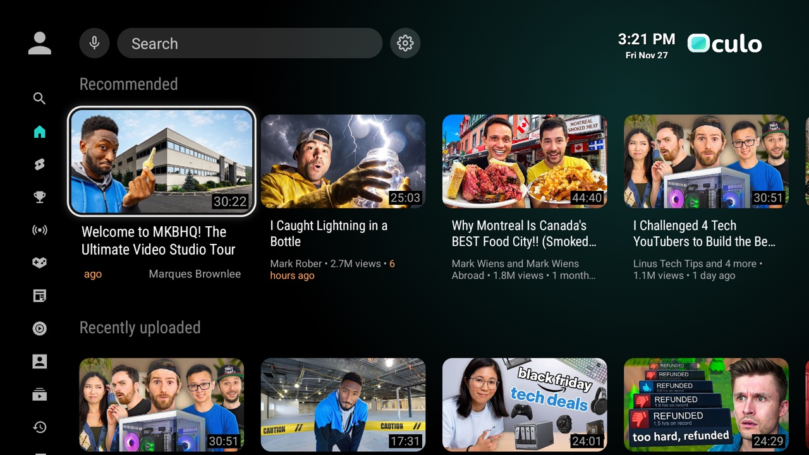
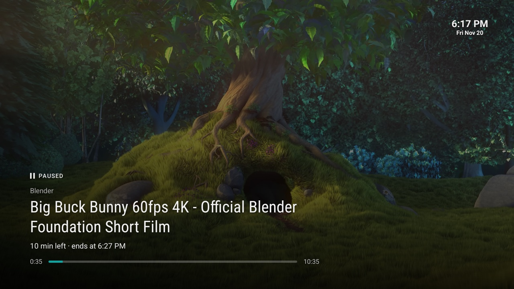
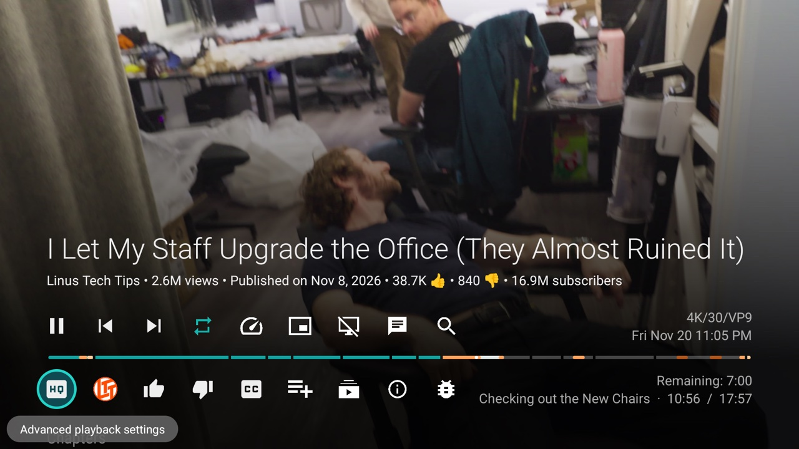
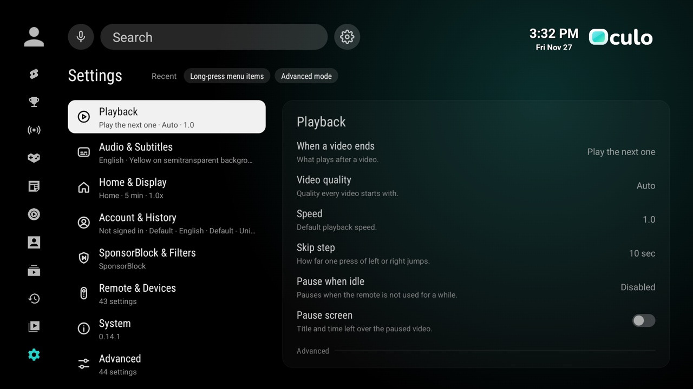
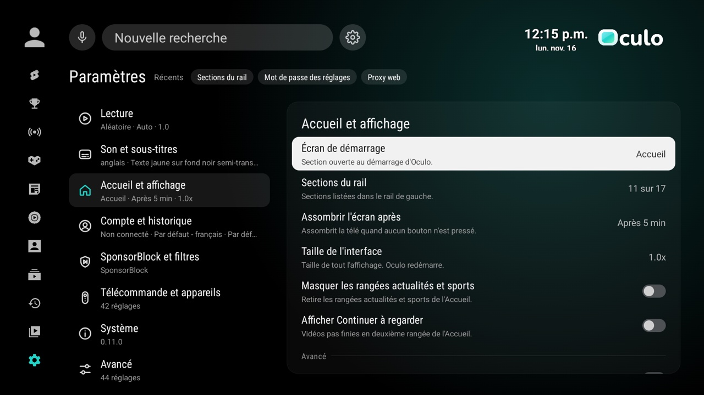

# Oculo

**Website: [francoisauger.github.io/oculo](https://francoisauger.github.io/oculo/)** (coming soon, not online yet)

Oculo is a free, open-source YouTube client for Android TV and Google TV, with a calm interface made for the remote. Its screens are in English and French, and it updates itself from this repository's [GitHub Releases](https://github.com/francoisauger/oculo/releases).



[Installation](#installation) · [Updates](#updates) · [Device support](docs/DEVICE-SUPPORT.md) · [Features](#features) · [Building](#building) · [Credits](#credits) · [License](#license)

## Screenshots

| | |
|:---:|:---:|
|  |  |
| Pause screen | Chapters and SponsorBlock segments on the seek bar |
|  |  |
| Settings | Settings, in French |

Screenshots taken on the Android TV emulator, signed out.

## Features

- **Look:** new logo and colors (teal, with an apricot accent for live, new and SponsorBlock signals), a left rail and top bar in the style of Google TV, focused cards with a pulsing ring and a background glow that takes the thumbnail's color, revised typography, redesigned search, sign-in (QR code generated on the device), empty and error screens.
- **Settings:** one screen with seven categories (Playback, Audio & Subtitles, Home & Display, Account & History, SponsorBlock & Filters, Remote & Devices, System), a simple mode by default and an advanced mode with everything else; dead and duplicated settings removed. The full original settings screens stay reachable under Advanced › Classic settings.
- **Panels:** every menu and drawer (video menu, player settings, comments, video info, accounts…) uses the same card at the right of the screen.
- **Continue watching:** Home's second row, unfinished videos from your account history (any device) and from Oculo.
- **Subscriptions:** a « new » dot on videos published since your last visit, and hiding watched videos in one step.
- **Pause screen:** a few seconds after pausing, the title, channel, time left and end time over the frozen frame (can be turned off).
- **Sleep timer:** in the player's panel: 15, 30, 45, 60 or 90 minutes, or end of the video, with a « Still watching? » notice before pausing.
- **Screensaver:** after 5 minutes without a key press, a clock, the date and thumbnails already in the app's cache (no extra requests), moving slowly against burn-in.
- **Player:** the seek bar is split into chapters and shows SponsorBlock segments at the same time; the current chapter's name shows by the time; optional Up key for the next chapter (advanced mode); original audio track by default instead of « voice boost » mixes.
- **Watch later:** first item of a video's long-press menu, with a confirmation.
- **Less background work:** no Android TV home-screen channels service (it ran every 15 minutes even with the app closed); no Firebase or Crashlytics.
- **Updates:** from Oculo's own GitHub Releases, signed with Oculo's key (see [Updates](#updates)).

Release notes per version (in French, as shown by the updater): [CHANGELOG.md](CHANGELOG.md). Developer notes, with every file the fork touches: [OCULO.md](OCULO.md).

## Installation

Oculo is only published here, on [GitHub Releases](https://github.com/francoisauger/oculo/releases/latest). It is not on Google Play, F-Droid or any APK site.

Each release has one APK per processor type:

| APK | For |
|---|---|
| `Oculo_<version>_armeabi-v7a.apk` | Most Android TVs and TV sticks, including 64-bit ones that run a 32-bit system (common on Google TV sets). **Pick this one if unsure**: it runs on ARM devices of both kinds. |
| `Oculo_<version>_arm64-v8a.apk` | Devices with a 64-bit system (`adb shell getprop ro.product.cpu.abi` prints `arm64-v8a`). |
| `Oculo_<version>_x86.apk` | x86 boxes and the Android TV emulator. |

`SHA256SUMS.txt` in each release lets you check the download.

Ways to get the APK onto the TV:

- With a downloader app on the TV (e.g. _Downloader by AFTVnews_), open the release's APK link.
- Download it on a computer, copy it to a USB stick and open it with a file manager app on the TV.
- With ADB: `adb install Oculo_<version>_armeabi-v7a.apk`.

The TV must allow installing apps from the app you use (Android's « unknown sources » / « Install unknown apps » setting). On Chromecast with Google TV and other Google TV devices this needs developer options first: see [Device support](docs/DEVICE-SUPPORT.md#chromecast-with-google-tv-and-other-google-tv-devices).

Install to internal storage, not to an SD card. If installation fails, check free space and download again.

## Updates

Install once; Oculo then updates itself. About 10 seconds after each start it checks this repository's latest release, picks the APK for your device's processor and, by default, adds an **Update** section at the top of the left rail with the release notes and an _Install update_ button. Android asks once to allow Oculo to install apps, then shows its usual install prompt.

- Settings › System › Check for updates: checks right away.
- Settings › System › About Oculo › _Check for updates automatically_: sidebar notification (default), dialog, or disabled.
- If you use a DNS filter, allow `github.com` and `release-assets.githubusercontent.com` (also `objects.githubusercontent.com`).

Updates must be signed with the same key as the installed app.

## Device support

Android TV and Google TV devices with Android 5.0 or later. Not for phones, and not for non-Android TVs (Samsung Tizen, LG webOS, Apple TV, Fire TV devices running Vega OS). Details, Chromecast with Google TV steps and known device issues: **[docs/DEVICE-SUPPORT.md](docs/DEVICE-SUPPORT.md)**.

## Using Oculo

**Casting from a phone.** Oculo does not appear by itself in the phone's cast list: link the phone once. On the TV, Settings › Remote & Devices › _Link a phone_ shows a code; in the YouTube app on the phone, go to Settings › General › Watch on TV › _Link with TV code_ and enter it. Oculo must be open on the TV before you cast.

**Voice search.** The microphone button next to the search bar uses the TV's own voice input. Oculo does not replace the system's global voice search.

**SponsorBlock.** Optional [SponsorBlock](https://sponsor.ajay.app/) support skips segments flagged by its community (sponsors, intros, reminders…); choose categories in Settings › SponsorBlock & Filters. Oculo only reads the database, it never submits or votes. Segments are missing when nobody has submitted them yet.

**Video quality and codecs.** Video quality is _Auto_ by default (the best available, up to the limit you set in Settings › Playback). Prefer VP9, or AV1 if your device decodes it in hardware; AVC only for old or slow devices: at the same resolution YouTube targets the same quality, newer codecs just use less bandwidth. HDR needs every link to support it (device, cable, TV).

## Building

Requirements: JDK 17, Android SDK (platform 34, build-tools 30.0.3), `local.properties` with `sdk.dir`.

```bash
git clone https://github.com/francoisauger/oculo.git
cd oculo
git submodule update --init --recursive
./gradlew :smarttubetv:assembleOculoDebug
```

Release builds, signing (the key is never in the repository) and publishing: see [OCULO.md](OCULO.md#build). A build signed with another key cannot update an installed Oculo from these releases: uninstall it first.

## Credits

Oculo is a fork of [SmartTube](https://github.com/yuliskov/SmartTube). Thank you to the SmartTube team for their hard work.

Oculo also relies on [SponsorBlock](https://sponsor.ajay.app/), [Return YouTube Dislike](https://returnyoutubedislike.com/), [ZXing](https://github.com/zxing/zxing) (QR codes) and other open-source libraries.

Found a problem? Open an issue in [this repository](https://github.com/francoisauger/oculo/issues).

## License

Oculo is released under the [MIT License](LICENSE); the original copyright notice is kept. Bundled libraries and submodules keep their own licenses. The software is provided as is, without warranty of any kind.

---

<sub>Oculo is an independent project, not affiliated with YouTube or Google.</sub>
